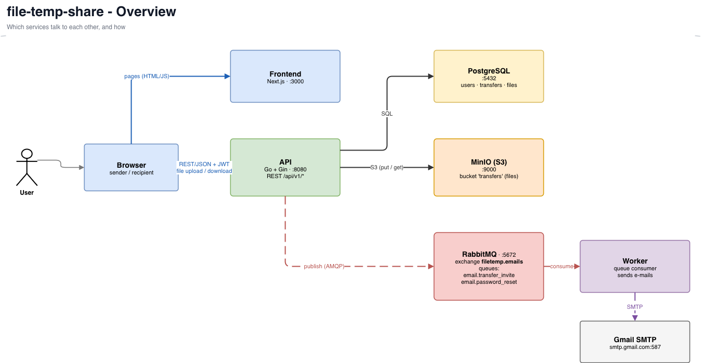
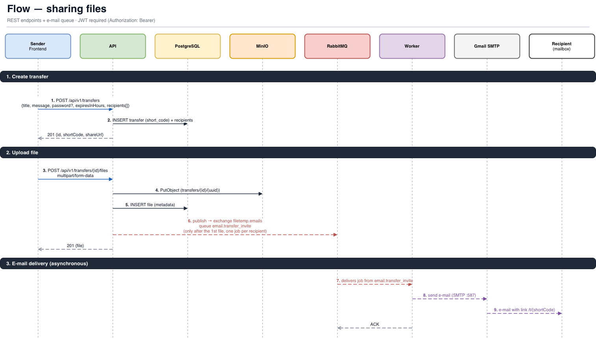
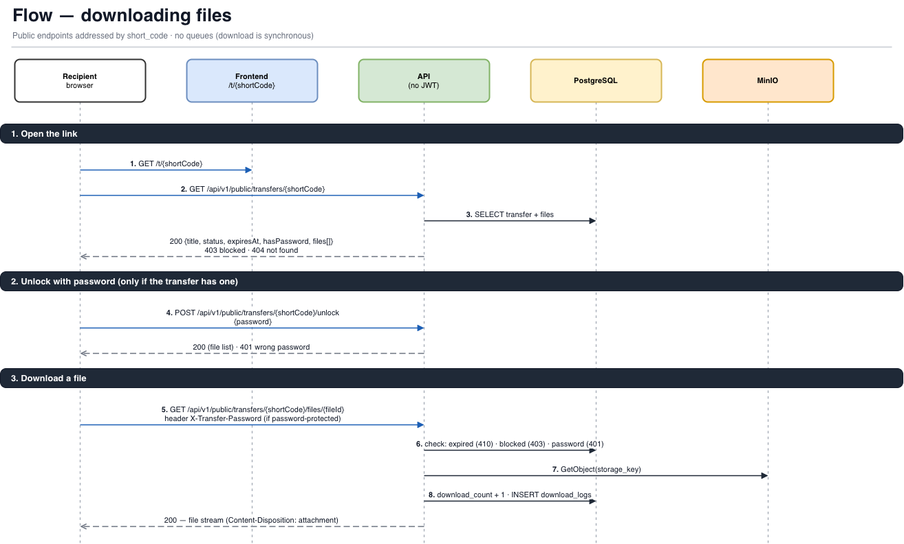
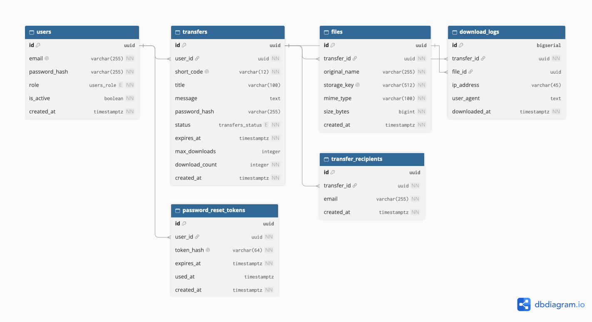

# FlashShare

Temporary file-sharing app inspired by WeTransfer. Create a **transfer**, attach files, share a link (and optionally email recipients), then let others download until the transfer expires.

Monorepo with a Go/Gin HTTP API, a background worker, a Next.js frontend, PostgreSQL, MinIO (S3), and RabbitMQ.

## Features

- **Accounts** — register, login, current user (`/me`), password reset (email via worker)
- **Transfers** — create a share package with title, message, expiry, optional password, and recipient emails
- **File upload** — multipart upload through the API into MinIO; invite emails sent after the first file is attached
- **Dashboard** — list and manage your transfers (active / expired filters, copy share link, open detail, delete)
- **Public download** — open `/t/:slug`, unlock with password if set, download files until expiry (**410** when expired)
- **Admin** — basic admin surface for blocked/user management (API + UI)

## Technologies

| Layer | Stack |
|-------|--------|
| Backend API | Go 1.23+, Gin, JWT (HS256) |
| API docs | swaggo/swag + Swagger UI |
| Database | PostgreSQL 16, pgx/v5, sqlc, golang-migrate |
| Object storage | MinIO (S3-compatible) — uploads proxied through the API |
| Async jobs | RabbitMQ + Go worker |
| Email | Gmail SMTP (app password) |
| Frontend | Next.js (App Router), React, TypeScript, Tailwind CSS |
| Tooling | Devbox, Taskfile (`go-task`), Docker Compose |

## Architecture

Browser talks to the Next.js UI and the Gin API. The API owns Postgres metadata and MinIO blobs; email goes out asynchronously through RabbitMQ and a worker.



## How it works

### Sharing a transfer

The sender creates a transfer (JWT), uploads files through the API into MinIO, then the worker emails recipients with the public link.



### Downloading files

Recipients open the public link — no account required. Optional password unlock, then the API streams the file from MinIO and records the download.



## Data model



## Prerequisites

- [Docker](https://docs.docker.com/get-docker/) and Docker Compose
- [Devbox](https://www.jetify.com/devbox) (for local tooling: Go, Node, Task, sqlc, …)
- [go-task](https://taskfile.dev/) (available inside Devbox)

Optional for email in local/Docker: Gmail address + [app password](https://support.google.com/accounts/answer/185833) in `.env` (`GMAIL_APP_LOGIN`, `GMAIL_APP_PASSWORD`).

## Getting started

1. Clone the repo and copy environment defaults:

```bash
cp .env.example .env
```

Edit `.env` if you need different ports, JWT secret, or Gmail credentials. Do not commit `.env`.

2. Enter the Devbox shell (installs/pins CLI tools):

```bash
devbox shell
```

3. Start the full stack (Postgres, MinIO, RabbitMQ, API, worker, frontend):

```bash
task infra:up
```

4. Apply migrations and (optionally) seed demo users:

```bash
task db:migrate:up
task db:seed
```

5. Open the apps:

| Service | URL |
|---------|-----|
| Frontend | http://localhost:3000 |
| API / Swagger | http://localhost:8080/swagger/index.html |
| MinIO console | http://localhost:9001 (`minioadmin` / `minioadmin`) |
| RabbitMQ management | http://localhost:15672 (`guest` / `guest`) |

Stop everything with `task infra:down`.

### Hybrid local development

Run infra in Docker, processes on the host:

```bash
task infra:up:db
task infra:up:mq
task infra:up:minio
task db:migrate:up

task api:swagger   # once, or after API annotation changes
task api:run
task worker:run    # needs Gmail env for real mail
task frontend:dev
```

Useful tasks: `task --list`, `task infra:logs`, `task infra:up:api`, `task test:unit`, `task test:int`.

## Project layout

```
doc/         Architecture and flow diagrams
backend/     Gin API (`cmd/api`) + worker (`cmd/worker`)
frontend/    Next.js App Router UI
tests/api/   Python (uv + pytest) API integration tests
Taskfile.yml Common commands
devbox.json  Dev toolbox
docker-compose.yml
```
